# Agent Architecture (C4+1)

> **Model:** C4 + Scenarios view
> **Scope:** Study Agent System — all agents, stores, data flows, and write gates
> **Last updated:** 2026-03-22

---

## Introduction

The Study Agent System is a multi-agent AI learning infrastructure built on Obsidian. It is designed as pedagogically-rigorous learning infrastructure — not a general-purpose chatbot — to help students achieve mastery through structured, repeatable study workflows.

The system orchestrates specialist agents (teaching, practice, fact-checking, compliance, profile, vault search, web search, indexing, and note writing) via a Copilot CLI specification (`study.agent.md`). The **Copilot CLI agent is the LLM** — Python tools are pure data fetchers and gate keepers. The LLM acts as the **Master Elaborator**, transforming raw tool output into rich, structured Learning Modules, and as the **Socratic Tutor**, guiding students to understanding through probing questions rather than direct answers. Every persistent learning artifact is written to an Obsidian vault as a Markdown note with YAML frontmatter, making all outputs human-readable, inspectable, and linkable inside the student's knowledge graph.

Four binding constraints govern the architecture:

- **Vault Constitution v1.2** — governing rules defining note standards, metadata doctrine, write governance, educational behaviour, and Obsidian-native linking
- **Sequential write-gate pipeline** — fact-check (Gate 1) then compliance (Gate 2) then write; fail-fast, no skipping
- **Single write endpoint** — `note_writer_agent.py` enforces both gates at code level; no agent or developer may bypass it
- **Obsidian wikilink standard** — all internal vault references use `[[wikilink]]` syntax (§V rule 8); source traceability requires `[Title](URL)` for web and `[[note]]` for vault references (§X rule 6)

---

## Contents

1. [Level 1 — System Context](#level-1--system-context)
2. [Level 2 — Container Diagram](#level-2--container-diagram)
3. [Level 3 — Component Diagram](#level-3--component-diagram)
4. [Level 4 — Code / Module Map](#level-4--code--module-map)
5. [+1 — Key Scenarios](#1--key-scenarios)
6. [Architecture Decisions](#architecture-decisions)
7. [Data Flow Summary](#data-flow-summary)

---

## Level 1 — System Context

> *Who uses the system and what external systems does it depend on?*

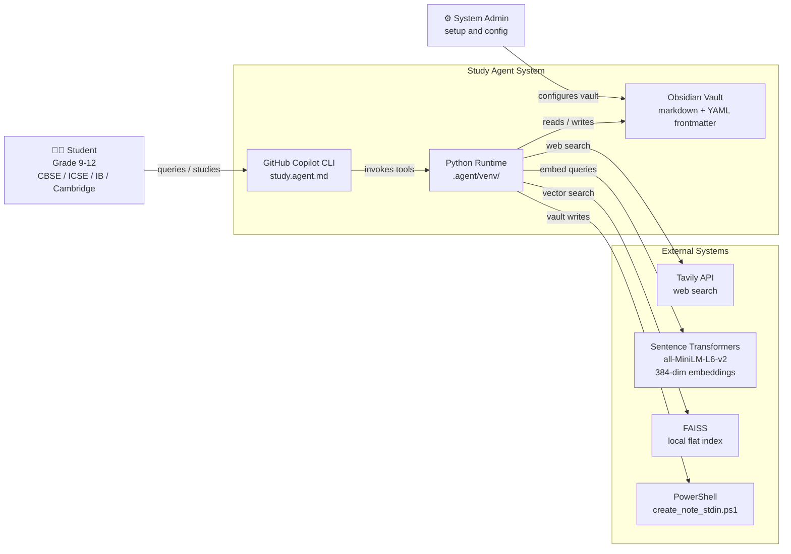

### Actors

| Actor | Type | Description |
|-------|------|-------------|
| **Student** | Human | Primary user — queries, studies, takes practice tests |
| **System Administrator** | Human | Sets up vault, creates initial profile |
| **Copilot CLI** | External System | AI orchestration runtime; reads `study.agent.md` |
| **Tavily API** | External System | Web search engine for educational content |
| **Sentence Transformers** | External Library | Local embedding model (no network call at inference) |
| **FAISS** | External Library | Local vector similarity search |
| **PowerShell** | External Runtime | File system operations for vault writes |

---

## Level 2 — Container Diagram

> *What are the major deployable/runnable building blocks?*

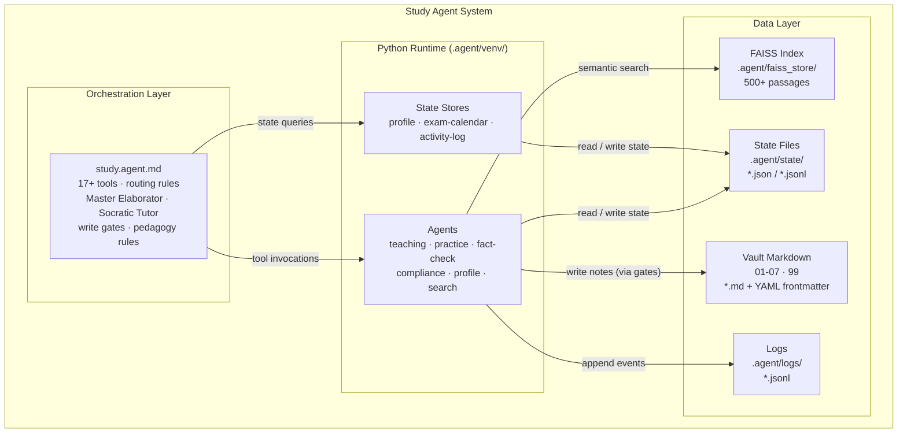

### Containers

| Container | Technology | Responsibility |
|-----------|-----------|----------------|
| **Orchestration Layer** | `study.agent.md` (Copilot CLI spec) | Routes student intent to tools; the CLI agent IS the LLM — acts as Master Elaborator (transforms raw tool JSON into Learning Modules) and Socratic Tutor; enforces pedagogy and gate rules |
| **Python Runtime** | Python 3.9+, venv at `.agent/venv/` | Executes all agents and stores |
| **FAISS Index** | FAISS flat index + `metadata.jsonl` | Semantic search over 500+ vault passages |
| **State Files** | JSON / JSONL in `.agent/state/` | Learner profile, mastery, revision queue, exam calendar |
| **Vault Markdown** | Markdown + YAML frontmatter | Persistent knowledge base (Obsidian-compatible) |
| **Logs** | JSONL in `.agent/logs/` | Session and activity audit trail |

---

## Level 3 — Component Diagram

> *What are the components inside the Python Runtime container?*

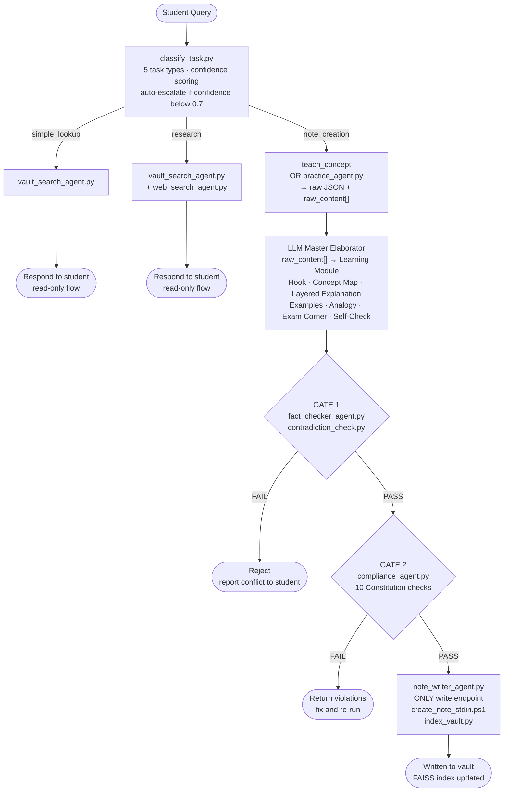

### Component Catalogue

#### Routing

| Component | File | Responsibility |
|-----------|------|----------------|
| **Task Classifier** | `classify_task.py` | Parses query to task type + confidence; auto-escalates if confidence < 0.7 |

#### Retrieval

| Component | File | Responsibility |
|-----------|------|----------------|
| **Vault Search Agent** | `vault_search_agent.py` | Semantic vault search; returns findings + recommends web fallback if score < 0.6 |
| **FAISS Query** | `query_vault.py` | Low-level FAISS wrapper; top-k cosine similarity search |
| **Web Search Agent** | `web_search_agent.py` | Tavily API wrapper; educational source filtering |
| **Web Fetch** | `web_fetch.py` | Fetches and normalises full web page content |

#### Content Generation

| Component | File | Responsibility |
|-----------|------|----------------|
| **Teaching Agent** | `teaching_agent.py` | Level-adapted concept explanation; adapts to grade + learning_style; vault-first with web fallback at threshold 0.6; returns `raw_content[]` (full unprocessed vault/web chunks) for LLM elaboration alongside `explanation`, `examples`, `key_points`, `exam_tips` |
| **Practice Agent** | `practice_agent.py` | Generates 5 question types (MCQ, short_answer, long_answer, fill_blank, true_false); board-aware marking scheme |
| **Marking Scheme Store** | `marking_scheme_store.py` | Single source of truth for marking rules across CBSE, ICSE, IB, Cambridge, Generic |

#### Write Gates

| Component | File | Gate | Pass Condition |
|-----------|------|------|----------------|
| **Fact Checker** | `fact_checker_agent.py` | Gate 1 | `pass: true` — no vault contradictions (negation, numeric mismatch) |
| **Contradiction Check** | `contradiction_check.py` | Gate 1 (sub) | CLEAR or REVIEW verdict; CONFLICT fails Gate 1 |
| **Compliance Agent** | `compliance_agent.py` | Gate 2 | `status: PASS` — all 10 Constitution checks pass; valid types include `learning-module` (added 2026-03-22) |

#### Vault Write

| Component | File | Responsibility |
|-----------|------|----------------|
| **Note Writer Agent** | `note_writer_agent.py` | Only vault write endpoint; validates both gates internally; routes by note_type — `concept` + `learning-module` → `04 - Concepts`, `practice` → `05 - Practice`, `revision-plan` + `exam` → `06 - Plans` |
| **Create Note** | `create_note.py` + `create_note_stdin.ps1` | Atomic file creation via PowerShell |
| **Vault Indexer** | `index_vault.py` | Rebuilds FAISS index from all vault markdown; runs post-write |

#### Profile and State

| Component | File | Responsibility |
|-----------|------|----------------|
| **Profile Agent** | `profile_agent.py` | Interactive profile CRUD; writes student card to `01 - Inbox/` |
| **Learner Profile Store** | `learner_profile_store.py` | Read/write `learner-profile.json`; exposes `get_board()`, `get_grade()` |
| **Exam Calendar Store** | `exam_calendar_store.py` | Read/write `exam-calendar.json`; upcoming exam queries |
| **Activity Log Store** | `activity_log_store.py` | Append-only JSONL event log to `.agent/logs/` |

#### Infrastructure

| Component | File | Responsibility |
|-----------|------|----------------|
| **Path Constants** | `paths.py` | Single source of truth for all file system paths; derived from `__file__` location — vault-portable |
| **Generate Presentation** | `generate_presentation.py` | Renders vault markdown notes as HTML slide presentations |
| **Archive and Reset** | `archive_and_reset.py` | Batch-archives content folders to `99 - Archive/`; re-indexes |

---

## Level 4 — Code / Module Map

> *Key internal structures for the most complex modules.*

### `classify_task.py` — Signal Routing

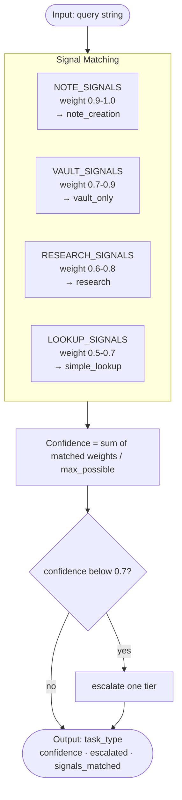

### `note_writer_agent.py` — Gate Enforcement

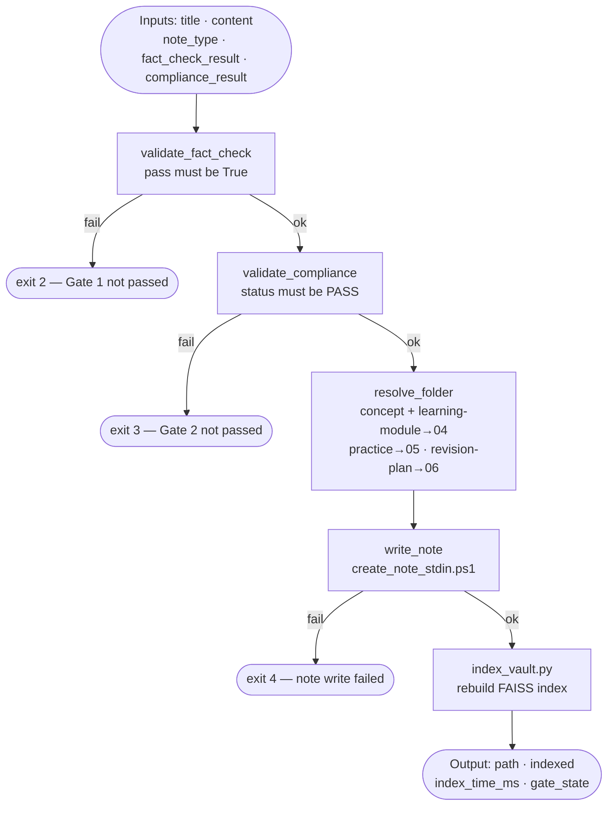

### `practice_agent.py` — Question Generation

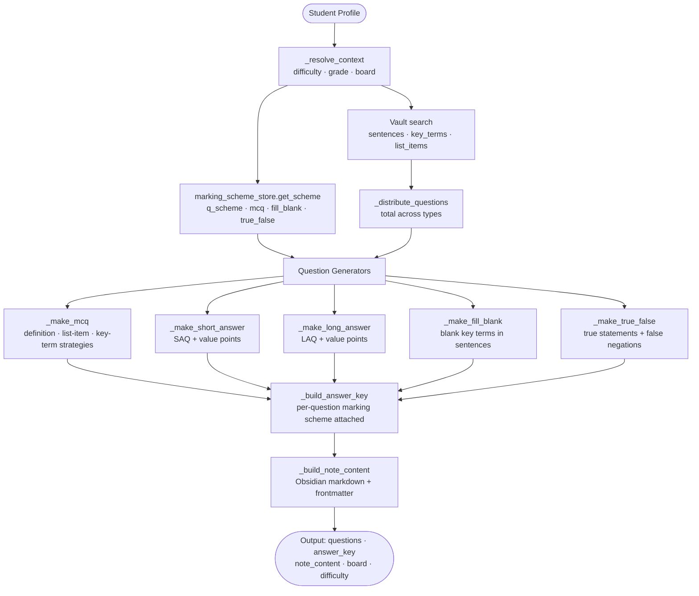

### `teaching_agent.py` — Level Adaptation

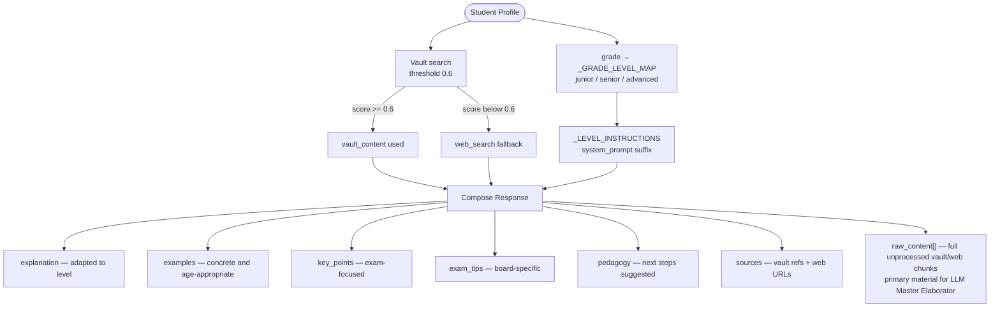

---

## +1 — Key Scenarios

> *End-to-end walkthroughs of the most important use cases.*

---

### Scenario 1: Student asks "Explain photosynthesis"

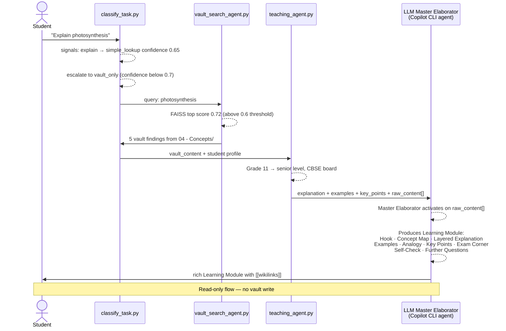

---

### Scenario 2: Student asks "Create a concept note on osmosis"

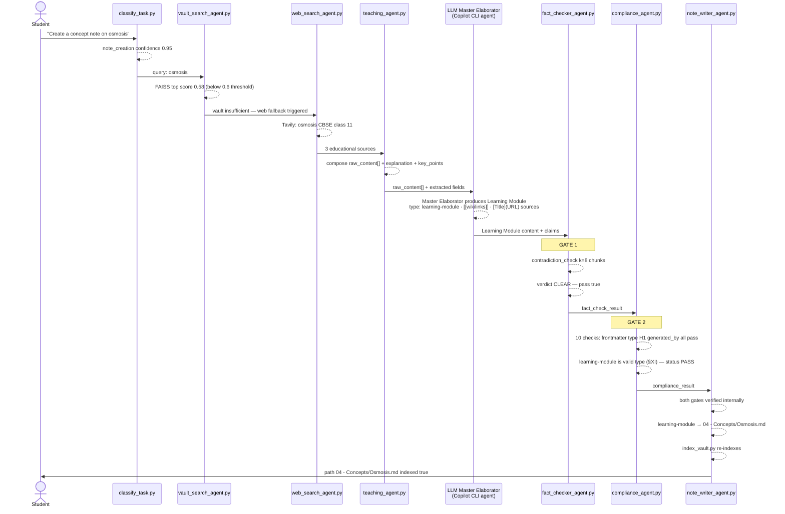

---

### Scenario 3: Student adds a new subject

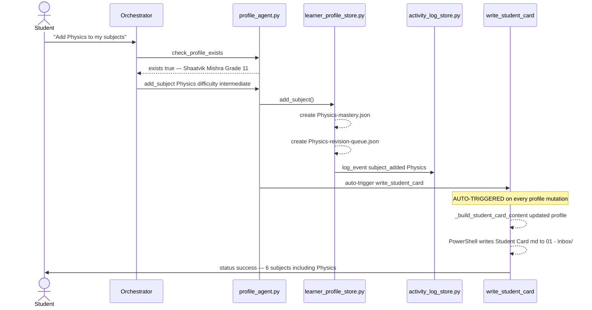

---

### Scenario 4: Practice question generation (board-aware)

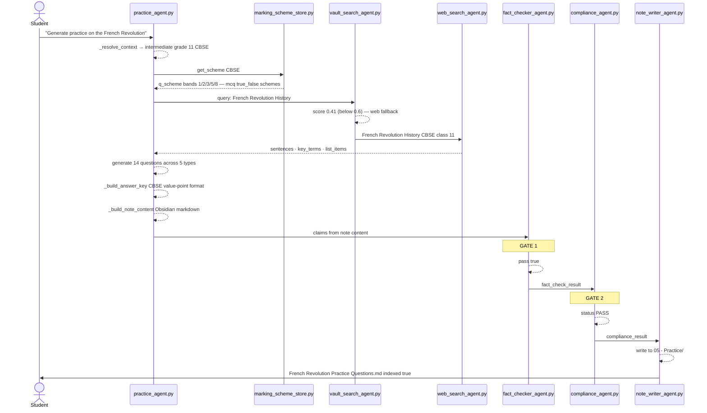

---

## Architecture Decisions

| # | Decision | Rationale |
|---|----------|-----------|
| **AD-1** | `paths.py` as single source of truth for all paths | Vault-portable: moving the vault to any directory requires zero code changes |
| **AD-2** | Sequential fail-fast gates (Fact then Compliance then Write) | Prevents bad data from entering vault; Gate 2 never runs if Gate 1 fails |
| **AD-3** | `note_writer_agent.py` as the only vault write endpoint | Single point of enforcement; no agent can bypass gates |
| **AD-4** | Vault score threshold 0.6 for web fallback | Below 0.6 the vault content is not reliably relevant; web search adds marginal value above it |
| **AD-5** | Task auto-escalation at confidence < 0.7 | Low-confidence classification should err toward more thorough processing |
| **AD-6** | Board-aware marking via `marking_scheme_store.py` | Supporting multiple boards (CBSE, ICSE, IB, Cambridge) requires centralised scheme data |
| **AD-7** | Student card auto-refreshed on every profile mutation | Obsidian vault always reflects current profile without a separate sync step |
| **AD-8** | State in JSON/JSONL, not a database | Obsidian-first philosophy: all learner state lives inside the vault and is human-readable |
| **AD-9** | FAISS flat index (no IVF/HNSW) | Vault size below 10,000 passages makes exact search faster than approximate; no training step |
| **AD-10** | all-MiniLM-L6-v2 cached locally | No network dependency at inference time; works fully offline |
| **AD-11** | Copilot CLI agent IS the LLM elaboration layer | Python tools are pure data fetchers; the LLM (Copilot CLI) does all generative work; no new Python LLM API services needed — just prompt engineering in `study.agent.md` |
| **AD-12** | `[[wikilinks]]` required for all internal vault references (§V rule 8) | Obsidian builds its knowledge graph from wikilinks; without them, notes are isolated islands rather than a connected second brain |
| **AD-13** | `[Title](URL)` required for web sources; `[[note]]` for vault (§X rule 6) | Full source traceability — every claim traceable to its origin; ` ` required in Mermaid node labels (Obsidian does not support `\n` escape in diagram labels) |

---

## Data Flow Summary

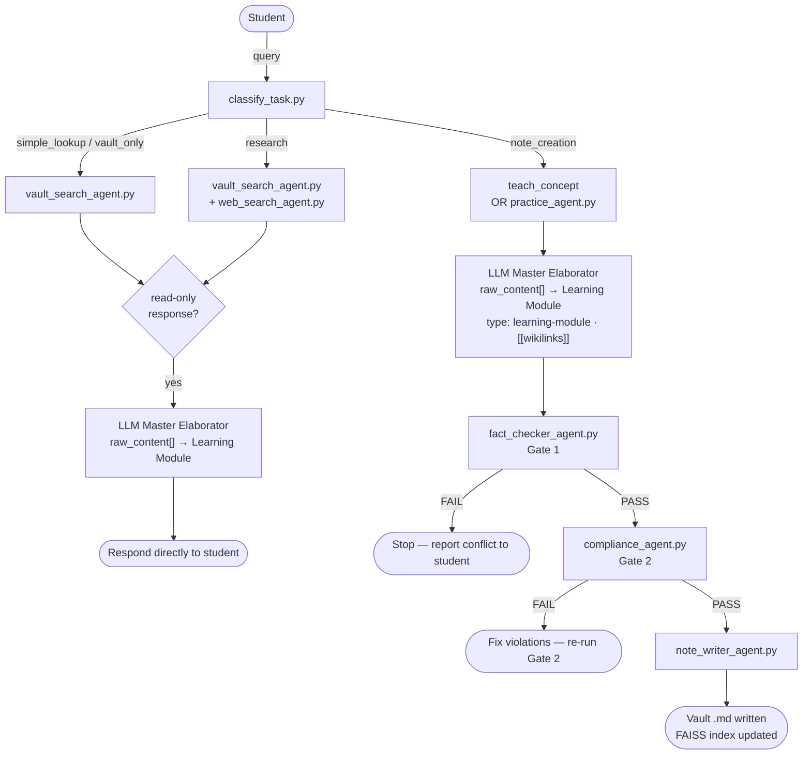

---

*Generated by Copilot — Study Agent System, 2026-03-22*
