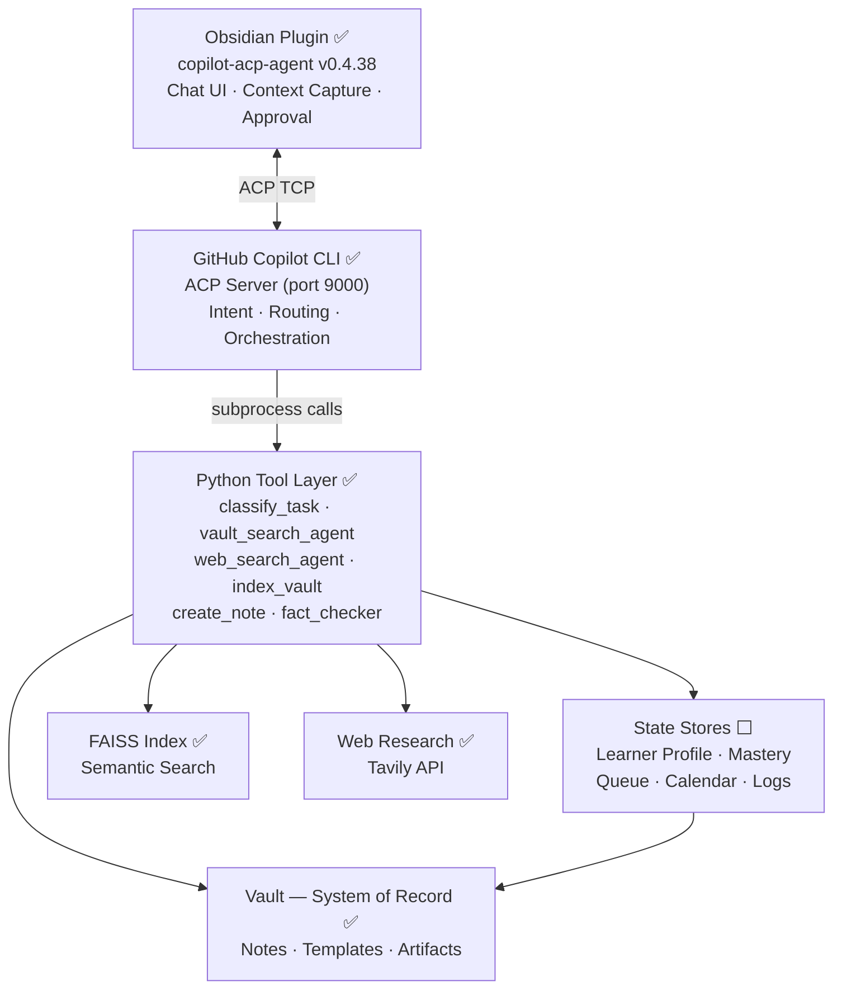
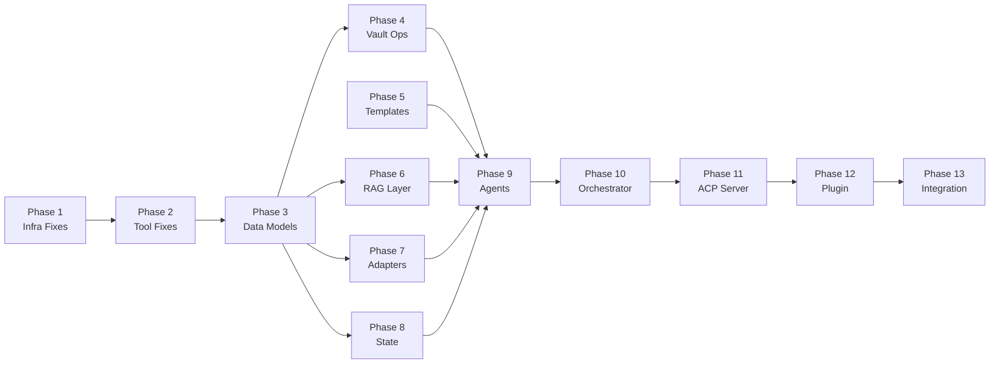

# Study Agent Build Plan

---

## ⏩ Resume Point — Last session ended here

### ✅ Infrastructure Layer Complete (Phases 1–2 + UI)

All core tools are audited, fixed, and tested end-to-end:

| Tool | State |
|---|---|
| `paths.py` | ✅ All constants correct, state/ and logs/ created |
| `index_vault.py` | ✅ Frontmatter parsing, text in metadata, no CLI args |
| `query_vault.py` | ✅ text field populated, note_type/subject/topic in output |
| `contradiction_check.py` | ✅ paths.py-first, no positional path args |
| `vault_search_agent.py` | ✅ Correct subprocess signatures, metadata forwarded |
| `web_fetch.py` | ✅ StudyAgent/1.0 user-agent, 2000-char snippet |
| `web_search_agent.py` | ✅ Study-domain tiers + India Gold/Silver/Bronze sites |
| `fact_checker_agent.py` | ✅ Vault + web check, study-domain keywords, correct CLI |
| `compliance_agent.py` | ✅ 10 constitution checks, PASS/FAIL + violations JSON |
| `note_writer_agent.py` | ✅ 2-gate write guard, type→folder auto-routing, tested |
| `create_note_stdin.ps1` | ✅ Stale index_vault.py args removed |
| `create_note.py` | ❌ G18/G19/G20 bugs still open — fix before vault grows |
| `classify_task.py` | ❌ G11 — research domain task types, needs study rewrite |
| `archive_and_reset.py` | ❌ G12 — hardcoded research folder names |
| `generate_presentation.py` | ❌ G14 — Philips branding to strip |

### ✅ UI & Backend Integration Complete

| Component | State |
|---|---|
| **Obsidian Plugin** | ✅ Built & Installed (v0.4.38) |
| **ACP Backend** | ✅ Using GitHub Copilot CLI in ACP mode |
| **Protocol** | ✅ ACP over TCP (port 9000) |

**Architecture:** Plugin → ACP TCP → Copilot CLI → Python Tools → Vault

### 🔜 Next tasks in order

1. **Fix `create_note.py`** (G18, G19, G20) — 3 small bugs, unblock note frontmatter correctness
2. **Fix `classify_task.py`** (G11) — rewrite task types for study domain
3. **Fix `archive_and_reset.py`** (G12) — update folder names to study structure
4. **Strip branding from `generate_presentation.py`** (G14)
5. **Phase 3: Data Models** — `VaultChunk`, `LearnerProfile` (simplified for Copilot CLI integration)
6. **Phase 4: Vault Operations** — `vault_reader.py`, `vault_writer.py`, `link_graph.py`
7. **Phase 5: Vault Templates** — 8 note templates in `08 - Templates\`
8. **Phase 6: RAG Layer** — `vault_retriever.py`, `confidence_assessor.py`, `evidence_merger.py`
9. **Phase 7: State Management** — learner profile, mastery, queue, exam calendar stores
10. **Phase 8: Study Workflows** — Teaching, Practice, Diagnostic, Revision workflows as tool compositions
11. **Phase 9: Integration & Testing** — End-to-end validation with Copilot CLI orchestration

---

## Problem Statement

Build a Python-first, Obsidian-native, multi-agent learning system that helps students study, practice, revise, and prepare for exams. The system uses GitHub Copilot CLI as the ACP backend (orchestration layer), Python tools for vault operations and RAG, an Obsidian plugin frontend for chat UI, and the vault as the system of record.

## ✅ Architecture Update (v4.0)

**REVISED:** The system now leverages GitHub Copilot CLI's built-in ACP server and agent orchestration capabilities, simplifying the architecture:

```
[Obsidian Plugin] ✅ COMPLETE
    ↓ ACP TCP (port 9000)
[GitHub Copilot CLI] ✅ EXTERNAL
    ↓ calls tools via subprocess
[Python Tool Layer] ✅ MOSTLY COMPLETE
    ↓ operates on
[Vault + FAISS + Web] ✅ WORKING
```

**What this means:**
- ✅ **Phase 11 (Custom ACP Server):** NOT NEEDED - Using Copilot CLI instead
- ✅ **Phase 12 (Obsidian Plugin):** COMPLETE - copilot-acp-agent v0.4.38 installed
- ✅ **Phase 10 (Orchestrator):** SIMPLIFIED - Copilot CLI handles orchestration
- ✅ **Phase 9 (Specialist Agents):** REFRAMED - Study workflows as tool compositions, not separate Python agents

The Python layer provides **domain-specific tools** that Copilot CLI orchestrates based on student queries.

---

## Governing Constraints

- All files within vault boundary: `C:\GitViews\Obsidian_Study_Agent\`
- Python-first: reuse existing venv and tools — no new frameworks
- Vault-first RAG: 0.70 confidence threshold → Tavily web search (tiered fallback)
- CPU-only: local embeddings via `all-MiniLM-L6-v2`
- Approval-gated writes: backend proposes → plugin mediates → student approves
- Hub-and-spoke orchestration: one Orchestrator controls all specialist agents
- Filename = H1 heading = link text (no date prefixes, no annotation suffixes)
- Every agent-created note must declare `type` in frontmatter

---

## What Already Exists

### ✅ Working Tools (source present)

| File | What It Does |
|---|---|
| `paths.py` | Vault-portable path constants — VAULT_ROOT, FAISS_STORE, MODEL_PATH, PYTHON_EXE, SESSION_LOG, STATE_DIR, LOGS_DIR, all 9 vault folder constants |
| `index_vault.py` | FAISS vault indexer — heading-based chunking, frontmatter parsing, note_type/subject/topic in metadata |
| `query_vault.py` | FAISS semantic search — returns ranked chunks with file_path, heading, block_id, text, note_type, subject, topic, score |
| `contradiction_check.py` | Vault contradiction detector — negation, numeric mismatch, keyword absence; paths.py-first CLI |
| `vault_search_agent.py` | Vault search agent — wraps query_vault.py + contradiction_check.py; forwards note_type/subject/topic |
| `web_search_agent.py` | Tavily web search — study-domain quality tiers (Gold/Silver/Bronze/Skip) including India edu sites |
| `web_fetch.py` | Single-page HTML fetcher — title, publish_date, description, 2000-char text snippet |
| `fact_checker_agent.py` | Claim verifier — vault contradiction check + web source cross-check; study-domain keyword extraction |
| `compliance_agent.py` | Constitution compliance checker — 10 checks, returns PASS/FAIL + violations with rule/location/fix |
| `note_writer_agent.py` | Gated vault write agent — approval-gated, calls compliance_agent before writing (needs create_note.py fixes) |
| `classify_task.py` | Query classifier — 5 types with 0.70 confidence escalation (needs study-domain rewrite, G11) |
| `create_note.py` | Note creator — writes markdown with frontmatter (3 bugs pending: G18, G19, G20) |
| `generate_presentation.py` | HTML slide deck generator from markdown (Philips branding pending removal, G14) |
| `archive_and_reset.py` | Vault archiver — moves content to 99-Archive (hardcoded research folders pending fix, G12) |

### ✅ Infrastructure Present

| Asset | Status |
|---|---|
| Python venv at `00 - System\.agent\venv\` | ✅ Installed (85 packages: faiss-cpu, sentence-transformers, torch, PyYAML, requests, tavily-python) |
| FAISS index at `00 - System\.agent\faiss_store\` | ✅ Rebuilt from correct vault — 120 passages, 384-dim |
| Model at `00 - System\.agent\models\all-MiniLM-L6-v2\` | ✅ Extracted and working |
| `session_log.jsonl` | ⚠️ Wrong schema (research agent) — must redefine (G15) |
| `00 - System\.agent\state\` directory | ✅ Created |
| `00 - System\.agent\logs\` directory | ✅ Created |

### ❌ Agents Still Pending Build

`orchestrator.py` · `session_logger.py`

---

## Known Gaps (Must Fix Before or During Build)

These issues were identified by auditing all existing tools against the vault constitution and architecture spec.

### 🔴 Critical — Broken or Entirely Missing

| ID | Status | Gap | Tool / Area |
|---|---|---|---|
| G01 | ✅ Fixed | FAISS index built from wrong vault (`ai_notes`) — re-indexed from correct vault | `faiss_store\` |
| G02 | ✅ Fixed | Embedding model not extracted — `all-MiniLM-L6-v2\` directory does not exist | `models\` |
| G03 | ✅ Fixed | `contradiction_check.py` had wrong CLI signature — passes `faiss_store`/`model_path` now removed | `vault_search_agent.py` |
| G04 | ✅ N/A | Orchestrator deleted → NOW HANDLED BY COPILOT CLI (no custom orchestrator needed) | N/A |
| G05 | 🔶 Reframed | No study-domain agents exist → SIMPLIFIED: Study workflows as tool compositions called by Copilot CLI | `workflows\` |
| G06 | ✅ N/A | No ACP server → USING GITHUB COPILOT CLI instead (no custom server needed) | N/A |
| G07 | ✅ Complete | No Obsidian plugin → PLUGIN BUILT & INSTALLED (copilot-acp-agent v0.4.38) | `.obsidian\plugins\` |
| G08 | ⬜ Open | No state management — no stores, no JSON files, `state\` directory exists but empty | `state\` |
| G09 | ⬜ Open | No vault templates — `08 - Templates\` is empty, no note structure for agent output | `08 - Templates\` |
| G10 | 🔶 Simplified | No data models — simplified due to Copilot CLI integration (fewer models needed) | `models\` |

### 🟠 High — Tool Exists But Wrong Domain or Broken Logic

| ID | Status | Gap | Tool |
|---|---|---|---|
| G11 | ⬜ Open | Task types are for research (`simple_lookup`, `vault_only`, `multi_topic_research`) not study (`explain`, `practice`, `diagnose`, `plan`, `review`) | `classify_task.py` |
| G12 | ⬜ Open | Archive folders hardcoded to old research structure (`03 - Research`, `04 - Evergreen`) — study folders (`03 - Subjects`, `04 - Concepts`, `05 - Practice`) are never touched | `archive_and_reset.py` |
| G13 | ⬜ Open | Setup script says "Research Agent Vault", references `research.agent.md` and `maintenance.agent.md` which do not exist | `setup_windows.ps1` |
| G14 | ⬜ Open | Presentation generator is corporate-branded (Philips logo embedded in base64) — misaligned with study artifact outputs | `generate_presentation.py` |
| G15 | ⬜ Open | Session log schema records `fact_check_result`, `compliance_result` — study agent needs `intent`, `mastery_updates`, `artifact_operations`, `confidence_score` | `session_log.jsonl` |
| G16 | ✅ Fixed | Vault indexer now extracts `note_type`, `subject`, `topic` from frontmatter into chunk metadata | `index_vault.py` |
| G17 | ✅ Fixed | Semantic search now returns populated `text` field — `metadata.jsonl` stores passage text | `query_vault.py` |
| G18 | ⬜ Open | Auto-generated frontmatter missing `type:` field — violates Constitution §XI "every agent-created note must declare its type" | `create_note.py` |
| G19 | ⬜ Open | Duplicate-file counter logic ignores the `folder` parameter — deduplicated notes are created at vault root instead of target folder | `create_note.py` |
| G20 | ⬜ Open | Slugify regex `r'[^a-z0-9\\-\\_ ]'` is malformed — double-escaped backslashes in a raw string produce incorrect character class | `create_note.py` |
| G21 | ✅ Fixed | Web search quality tiers rebuilt for study domain — Gold/Silver/Bronze/Skip with India edu sites (nptel, ncert, byjus, etc.) | `web_search_agent.py` |

### 🟡 Medium — Structural or Integration Issues

| ID | Status | Gap | Tool |
|---|---|---|---|
| G22 | ⬜ Open | `session_logger.py` deleted — no mechanism to write structured activity records; Memory Agent cannot read history | deleted |
| G23 | 🔶 Partial | `create_note_stdin.ps1` stale positional args to `index_vault.py` fixed ✅ — synchronous full-reindex on every write still present; async decoupling pending | `create_note_stdin.ps1` |
| G24 | ✅ Fixed | `vault_search_agent.py` excerpt field now populated — `note_type`, `subject`, `topic` also forwarded in findings | `vault_search_agent.py` |
| G25 | ⬜ Open | No `config.json` — vault root, server port, confidence threshold (0.70), model path not centrally configured; changing behaviour requires editing source | missing |
| G26 | ✅ Fixed | `paths.py` — added `STATE_DIR`, `LOGS_DIR`, fixed `SESSION_LOG` path, added all 9 vault folder constants; `state\` and `logs\` directories created on disk | `paths.py` |

---

## System Architecture (v4.0 - Copilot CLI Integration)



**Key Changes from Original Plan:**
- ✅ Plugin → Copilot CLI (not custom Python server)
- ✅ Copilot CLI handles orchestration (no custom orchestrator needed)
- ✅ Python tools called as subprocesses by Copilot CLI
- ⬜ Study workflows defined as tool compositions (not separate agent files)

---

## Phase 1: Infrastructure Fixes

Fix all broken infrastructure before writing any new code. Addresses G01, G02, G03, G12, G13, G15, G25, G26.

- [x] **1.1** `[G02]` Extract `all-MiniLM-L6-v2.zip` to `00 - System\.agent\models\all-MiniLM-L6-v2\` (run `setup_windows.ps1` or extract manually)
- [x] **1.2** `[G01]` Rebuild FAISS index for this vault by running `index_vault.py` against `C:\GitViews\Obsidian_Study_Agent`
- [x] **1.3** `[G03]` Remove `--check-contradictions` references from `vault_search_agent.py` or stub `contradiction_check.py` to return a safe no-op result
- [ ] **1.4** `[G13]` Update `setup_windows.ps1` — rename banner to "Student Study Agent Vault", remove references to `research.agent.md` and `maintenance.agent.md`, update next-step instructions
- [ ] **1.5** `[G25]` Create `config.json` — vault root, server port (default 7861), RAG confidence threshold (0.70), model path, external service flags
- [x] **1.6** `[G26]` Update `paths.py` — add `STATE_DIR = str(_AGENT_DIR / "state")`, `LOGS_DIR = str(_AGENT_DIR / "logs")`, fix `SESSION_LOG` to point inside `state\`
- [ ] **1.7** `[G15]` Redefine session log schema — replace `fact_check_result`/`compliance_result` with `intent`, `confidence_score`, `mastery_updates`, `artifact_operations`
- [x] **1.8** Create `00 - System\.agent\state\` directory
- [x] **1.9** Create `00 - System\.agent\logs\` directory

---

## Phase 2: Tool Fixes

Fix bugs and misalignments in the existing tools. Addresses G11, G12, G14, G16, G17, G18, G19, G20, G21, G23, G24.

- [ ] **2.1** `[G18]` Fix `create_note.py` — add `type:` field to auto-generated frontmatter (default to `output`; callers must pass explicit type)
- [ ] **2.2** `[G19]` Fix `create_note.py` — correct duplicate-file counter to use `target_dir / filename` not `vault / filename`
- [ ] **2.3** `[G20]` Fix `create_note.py` — fix slugify regex to `r'[^a-z0-9\-_ ]'`
- [x] **2.4** `[G16]` Extend `index_vault.py` — parse frontmatter from each note; store `note_type`, `subject`, `topic`, `level` in chunk metadata alongside existing fields
- [x] **2.5** `[G17]` Fix `query_vault.py` — populate `text` field in results from `metadata.jsonl` (store text at index time, or re-read the source file at query time)
- [x] **2.6** `[G24]` Fix `vault_search_agent.py` — propagate `text` into `excerpt` field so agents receive actual passage content
- [ ] **2.7** `[G11]` Rewrite `classify_task.py` for study domain — replace task types with `explain`, `practice`, `diagnose`, `plan`, `review`, `lookup`; replace research signal patterns with study signal patterns
- [ ] **2.8** `[G12]` Fix `archive_and_reset.py` — update `SOURCE_FOLDERS` to match study vault structure: `02 - Sources`, `03 - Subjects`, `04 - Concepts`, `05 - Practice`, `06 - Plans`, `07 - Outputs`
- [x] **2.9** `[G21]` Extend `web_search_agent.py` Tier 2/3 — add study-relevant educational sites: `khanacademy.org`, `bbc.co.uk/bitesize`, `sparknotes.com`, `cliffsnotes.com`, `brilliant.org`, `mathisfun.com`
- [x] **2.10** `[G23]` Fix `create_note_stdin.ps1` — stale positional args to `index_vault.py` removed ✅ · async decoupling still pending (vault scales)
- [ ] **2.11** `[G14]` Strip Philips branding from `generate_presentation.py` — remove embedded logo base64, replace brand CSS with neutral study-appropriate styling

---

## Phase 3: Data Models

Define all shared data contracts. Every agent and tool depends on these. Addresses G10.

- [ ] **3.1** Create `00 - System\.agent\study_agent\models\__init__.py`
- [ ] **3.2** `[G10]` Create `models\requests.py` — `PluginRequest`: `intent`, `message`, `current_note_path`, `selected_text`, `frontmatter`, `linked_notes`, `exam_context`, `permissions`, `session_id`
- [ ] **3.3** `[G10]` Create `models\responses.py` — `PluginResponse`: `chat_reply`, `proposed_artifact_operations`, `suggested_next_actions`, `provenance_metadata`, `state_update_proposals`, `session_id`
- [ ] **3.4** `[G10]` Create `models\rag_models.py` — `VaultChunk` (chunk_id, note_path, note_type, subject, topic, heading_path, text, content_hash), `EvidenceBundle`, `RetrievalResult`
- [ ] **3.5** `[G10]` Create `models\state_models.py` — `LearnerProfile`, `MasteryRecord`, `RevisionQueueItem`, `ExamEntry`, `ActivityEvent`
- [ ] **3.6** `[G10]` Create `models\agent_models.py` — `AgentRequest`, `AgentResponse`, `AgentType` enum

---

## Phase 4: Vault Operations

Read, write, and parse vault notes. Wraps the fixed `create_note.py`.

- [ ] **4.1** Create `vault\frontmatter_parser.py` — parse and serialize YAML frontmatter from markdown
- [ ] **4.2** Create `vault\vault_reader.py` — read notes by path, list by type/subject/topic, extract metadata
- [ ] **4.3** Create `vault\vault_writer.py` — produce `ArtifactOperation` proposals; atomic write on approval (wraps fixed `create_note.py`)
- [ ] **4.4** Create `vault\link_graph.py` — extract `[[wikilinks]]`, build adjacency graph, resolve targets
- [ ] **4.5** Create `vault\templates.py` — load templates from `08 - Templates\`, render with context variables

---

## Phase 5: Vault Templates

Required note templates for all repeatable note types (Constitution §XIX). Addresses G09.

- [ ] **5.1** `[G09]` Create `08 - Templates\source-note.md` — frontmatter: type, title, author, url, subject, status
- [ ] **5.2** `[G09]` Create `08 - Templates\topic-note.md` — frontmatter: type, subject, topic, level, prerequisites, mastery, exam_relevance
- [ ] **5.3** `[G09]` Create `08 - Templates\concept-note.md` — frontmatter: type, subject, topic, level, prerequisites, mastery
- [ ] **5.4** `[G09]` Create `08 - Templates\practice-note.md` — frontmatter: type, subject, topic, practice_status, difficulty, linked_review
- [ ] **5.5** `[G09]` Create `08 - Templates\review-note.md` — frontmatter: type, subject, topic, review_status, score, linked_practice
- [ ] **5.6** `[G09]` Create `08 - Templates\revision-plan.md` — frontmatter: type, subject, days_remaining, exam_relevance, status
- [ ] **5.7** `[G09]` Create `08 - Templates\exam-note.md` — frontmatter: type, subject, exam_date, days_remaining, status
- [ ] **5.8** `[G09]` Create `08 - Templates\dashboard-note.md` — frontmatter: type, status, updated_by_agent; links to mastery, queue, plans

---

## Phase 6: RAG Layer

Thin wrapper over the fixed `index_vault.py`, `query_vault.py`, `vault_search_agent.py`, and rewritten `classify_task.py`.

- [ ] **6.1** Create `rag\vault_retriever.py` — call fixed `vault_search_agent.py` subprocess, parse results into `VaultChunk` list with text populated
- [ ] **6.2** Create `rag\confidence_assessor.py` — score retrieval result set; return float; apply 0.70 threshold
- [ ] **6.3** Create `rag\evidence_merger.py` — merge vault + web results into unified `EvidenceBundle`
- [ ] **6.4** Create `rag\knowledge_materializer.py` — convert `EvidenceBundle` into `ArtifactOperation` proposals
- [ ] **6.5** Create `rag\retrieval_logger.py` — append retrieval decisions to `00 - System\.agent\logs\retrieval-log.jsonl`

---

## Phase 7: External Retrieval Adapter

Wraps the existing `web_search_agent.py` (after study-domain fixes).

- [ ] **7.1** Create `adapters\web_search_adapter.py` — call fixed `web_search_agent.py` subprocess, parse `web_findings` into normalised results
- [ ] **7.2** Create `adapters\external_router.py` — route vault → web search based on confidence score and query type

---

## Phase 8: State Management

All learner state as JSON files inside the vault boundary. Addresses G08, G22.

- [ ] **8.1** `[G08]` Create `state\learner_profile_store.py` — CRUD for `00 - System\.agent\state\learner-profile.json`
- [ ] **8.2** `[G08]` Create `state\mastery_store.py` — CRUD for `subject-mastery.json`; track mastery level per concept
- [ ] **8.3** `[G08]` Create `state\revision_queue_store.py` — CRUD for `revision-queue.json`; add/remove/prioritize
- [ ] **8.4** `[G08]` Create `state\exam_calendar_store.py` — CRUD for `exam-calendar.json`; track exams and countdown
- [ ] **8.5** `[G22]` Create `state\activity_log_store.py` — append-only writes to `activity-log.jsonl` with study-domain schema
- [ ] **8.6** `[G08]` Initialise empty state JSON files: `learner-profile.json`, `subject-mastery.json`, `revision-queue.json`, `exam-calendar.json`

---

## Phase 9: Study Workflows (Reframed)

Build study-specific workflow tools that Copilot CLI can orchestrate. Each workflow is a Python tool that implements study logic.

- [ ] **9.1** Create `workflows\teaching_workflow.py` — explain concepts at appropriate level, generate examples, create concept notes
- [ ] **9.2** Create `workflows\practice_workflow.py` — generate quizzes/flashcards/drills, create practice notes
- [ ] **9.3** Create `workflows\diagnostic_workflow.py` — analyze answers, identify mistakes, update mastery
- [ ] **9.4** Create `workflows\revision_workflow.py` — create revision plans based on mastery and exam dates
- [ ] **9.5** Create `workflows\review_workflow.py` — generate review summaries and progress reports

**Note:** Copilot CLI orchestrates these workflows based on student queries. No separate agent files needed.

---

## Phase 10: Integration & Testing (Combined with Phase 13)

End-to-end validation with actual Copilot CLI orchestration.

- [ ] **10.1** Start Copilot CLI in ACP mode: `copilot --acp --port 9000`
- [ ] **10.2** Enable plugin in Obsidian; confirm chat panel connects
- [ ] **10.3** Test vault search: "what is photosynthesis" → retrieves from vault
- [ ] **10.4** Test teaching workflow: "explain photosynthesis" → creates concept note
- [ ] **10.5** Test practice workflow: "create quiz on photosynthesis" → generates quiz note
- [ ] **10.6** Test diagnostic workflow: submit answers → updates mastery
- [ ] **10.7** Test revision workflow: "plan for exam in 2 weeks" → creates revision plan
- [ ] **10.8** Confirm all state files inside vault boundary
- [ ] **10.9** Confirm all agent-created notes have `type` frontmatter and filename = H1
- [ ] **10.10** Create initial learner dashboard note in `07 - Outputs\`

---

## ~~Phase 11: ACP Server~~ (NOT NEEDED)

✅ **Using GitHub Copilot CLI instead.** No custom Python ACP server required.

---

## ~~Phase 12: Obsidian Plugin~~ (COMPLETE)

✅ **Plugin already built and installed:** copilot-acp-agent v0.4.38

Files present:
- `.obsidian/plugins/copilot-acp-agent/main.js` (40.4 KB)
- `manifest.json`, `styles.css`, `data.json`, `README.md`

Features:
- Right-side panel with chat UI
- ACP TCP connection to Copilot CLI
- Permission approval dialog
- Vault context passing

---

## ~~Phase 13: End-to-End Integration~~ (Merged with Phase 10)

---

## Dependency Order



---

## Gap Resolution Map

| Gap | Resolved In |
|---|---|
| G01 — Wrong vault index | Phase 1.2 |
| G02 — Model not extracted | Phase 1.1 |
| G03 — Missing contradiction_check.py | Phase 1.3 |
| G04 — Orchestrator deleted | Phase 10 |
| G05 — No study agents | Phase 9 |
| G06 — No ACP server | Phase 11 |
| G07 — No Obsidian plugin | Phase 12 |
| G08 — No state management | Phase 8 |
| G09 — No vault templates | Phase 5 |
| G10 — No data models | Phase 3 |
| G11 — Classifier wrong domain | Phase 2.7 |
| G12 — Archive wrong folders | Phase 2.8 |
| G13 — Setup wrong context | Phase 1.4 |
| G14 — Presentation branding | Phase 2.11 |
| G15 — Session log wrong schema | Phase 1.7 |
| G16 — Index missing study metadata | Phase 2.4 |
| G17 — Query returns empty text | Phase 2.5 |
| G18 — create_note missing type | Phase 2.1 |
| G19 — Counter ignores folder | Phase 2.2 |
| G20 — Slugify regex bug | Phase 2.3 |
| G21 — Missing study sources | Phase 2.9 |
| G22 — session_logger deleted | Phase 8.5 |
| G23 — Sync reindex on write | Phase 2.10 |
| G24 — Empty excerpts | Phase 2.6 |
| G25 — No config.json | Phase 1.5 |
| G26 — SESSION_LOG wrong path | Phase 1.6 |

---

## Success Criteria

- [ ] FAISS index built from this vault and returning relevant results
- [ ] Backend starts and ACP server responds on `/health` and `/request`
- [ ] Plugin chat panel visible and connected to backend
- [ ] Explain workflow returns teaching content to plugin chat
- [ ] Practice workflow writes an approved note to `05 - Practice\`
- [ ] Diagnostic workflow updates `subject-mastery.json`
- [ ] Revision plan workflow writes an approved note to `06 - Plans\`
- [ ] Vault RAG used before any web search call
- [ ] All state files inside vault boundary
- [ ] All agent-created notes have `type` frontmatter and filename = H1 heading
- [ ] All 26 identified gaps resolved
