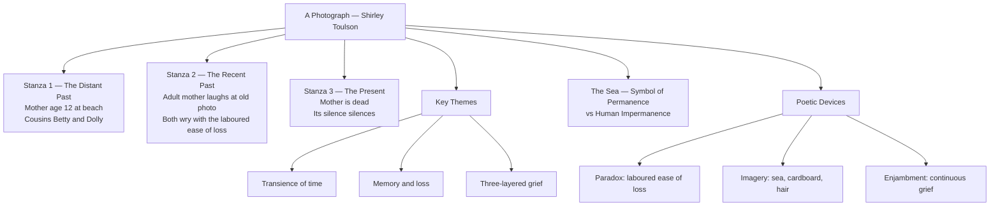

# A Photograph — Shirley Toulson

## Hook

A photograph never ages — but everything in it does. Shirley Toulson holds a cardboard photograph of her mother as a twelve-year-old, laughing at the beach. The mother who used to laugh at that photograph is now dead. And Toulson has nothing left to say. How does a poet write about a silence too heavy for words? That is the question this nineteen-line poem answers — and it does so in a way that will stay with you long after the exam.

## Concept Map

## The Poem

> The cardboard shows me how it was
> When the two girl cousins went paddling,
> Each one holding one of my mother's hands,
> And she the big girl — some twelve years or so.
> All three stood still to smile through their hair
> At the uncle with the camera. A sweet face,
> My mother's, that was before I was born.
> And the sea, which appears to have changed less,
> Washed their terribly transient feet.
>
> Some twenty — thirty — years later
> She'd laugh at the snapshot. "See Betty
> And Dolly," she'd say, "and look how
> They dressed us for the beach." The sea holiday
> Was her past, mine is her laughter. Both wry
> With the laboured ease of loss.
>
> Now she has been dead nearly as many years
> As that girl in the photograph was old.
> And of this circumstance
> There is nothing to say at all.
> Its silence silences.

## Layered Explanation

**Layer 1 — The Tweet:**
A poem about how time takes everything — youth, laughter, and finally even the words to describe the grief.

**Layer 2 — The Engine:**
The poem works through three time frames in three stanzas. Stanza 1: the photograph captures the mother as a carefree twelve-year-old at the beach — a moment before the poet existed. Stanza 2: years later, that same mother laughs at the photograph — her childhood is now her past. Stanza 3: the mother herself is dead. Now the poet's past is the memory of that laughter. Each stanza is a loss nested inside a loss. The sea, which appears to have changed less, is the poem's anchor of permanence — against which human transience is measured.

**Layer 3 — The Nuance:**
The structure of loss is layered: the mother lost her childhood (felt as nostalgia); the poet lost her mother (felt as grief); and now even the grief has matured into silence — "both wry with the laboured ease of loss." This is not raw pain. It is the exhausted familiarity of a grief carried so long it no longer requires expression. The final line "Its silence silences" is itself a silence: only four words, and they end everything. The poem performs what it describes.

## Worked Examples — Stanza Analysis

**Stanza 1 — The Distant Past (lines 1–9):**
The photograph shows mother (~12), Betty, and Dolly paddling at the beach, holding hands, smiling into the camera through their hair. The phrase "terribly transient" is the emotional peak — the sea is permanent; their feet in it are not. The poet was not yet born.

**Stanza 2 — The Recent Past (lines 10–15):**
As an adult, the mother laughs at the photo — at the hairstyles, the beach clothes. That laughter becomes the poet's most precious memory. "The sea holiday was her past, mine is her laughter" — a passing of loss from mother to daughter. "Both wry with the laboured ease of loss" means both griefs have become familiar, half-amused, half-painful.

**Stanza 3 — The Present (lines 16–19):**
The mother has been dead for nearly as many years as her age in the photograph — a stunning symmetry of time. The poet has nothing to say. The grief is beyond language: "Its silence silences." Four words. One full stop. The poem ends where words run out.

## Analogy

Imagine your favourite family video — maybe a birthday from when you were five. Now imagine that everyone in that video is gone. You watch it, but there is no one left to call and say "remember this?" The laughter in the video is your past now, not theirs. That is exactly where Shirley Toulson stands in Stanza 3. The photograph is still there. Everything else has been washed away — like footprints at the beach.

## Key Points

- The poem has three stanzas of 9, 6, and 4 lines — shrinking as grief matures into silence
- Three time frames: distant past (childhood photo) to recent past (mother's laughter) to present (mother's death)
- The sea symbolises permanence; human life is "terribly transient" by contrast
- Three layers of loss: mother's lost youth, poet's lost mother, silence beyond grief
- Key devices: paradox ("laboured ease"), imagery (sea, cardboard, hair), enjambment, metaphor ("sea holiday was her past")
- Written in free verse — no fixed rhyme or metre — mirroring the irregular flow of memory
- "Its silence silences" — reflexive construction; the poem performs the silence it describes

## Exam Corner

- **Marks:** Short answer = 2–3 marks; extract-based = 4–6 marks; long answer = 6 marks (CBSE Class 11 Hornbill)
- **Common mistake:** Describing only Stanza 1 for "three stages of time" questions. All three stanzas must be addressed with the shift in perspective.
- **Insider tip:** For device questions, cite "laboured ease of loss" (paradox/oxymoron) AND "Its silence silences" (reflexive construction). Name the device and explain its effect for full marks.

## Self-Check

1. **Why** does the sea "appear to have changed less" — and why does the poet include this detail at all?
2. **What if** the poem had a fourth stanza — what do you think Toulson could have written, and why do you think she chose silence instead?
3. **Compare** — How does the structure of the poem (stanzas getting shorter) mirror its meaning?

## Further Questions

1. The poem never directly says "I miss my mother." How does Toulson convey grief without stating it?
2. Compare the treatment of time and loss in "A Photograph" with another Hornbill poem you have studied.

## Related Notes

- [[English — Subject Map]]
- **Prerequisites:** [[Figures of Speech]] · [[Free Verse]]
- **Sibling poems:** [[The Laburnum Top]] · [[Voice of the Rain]] · [[Childhood]] · [[Father to Son]]
- **Practice:** [[A Photograph — Practice Questions]]

## Sources

- NCERT, *Hornbill — English Core*, Class 11, Poem 1: "A Photograph" — Shirley Toulson / Pergamon Press
- [CBSE Class 11 English A Photograph Summary](https://byjus.com/cbse-notes/class-11-english-a-photograph-summary/)
- [A Photograph — Summary, Critical Appreciation and Poetic Devices](https://englishliterature.education/articles/poetry-analysis/a-photograph-by-shirley-toulson-summary-critical-appreciation-and-poetic-devices/)
- [[English — Subject Map]]
