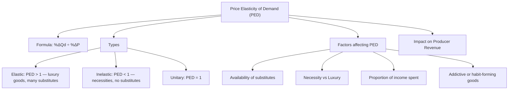

# Price Elasticity of Demand

## Hook

Apple charges ₹1,00,000 for a phone and people still queue overnight to buy it. A local bus raises fares by ₹5 and half the city switches to walking. Why does the same price increase trigger completely different behaviour? That is Price Elasticity of Demand — the single most powerful lens in economics for understanding how markets actually work.

## Concept Map

## Layered Explanation

**Layer 1 — The Tweet:** PED measures how sensitive buyers are to a price change — does demand crash, barely move, or stay exactly proportional?

**Layer 2 — The Engine:** The formula is: PED = % change in Quantity Demanded ÷ % change in Price. If price rises 20% and demand falls 20%, PED = −1 (unitary elastic). If demand only falls 10%, PED = −0.5 (inelastic). If demand falls 50%, PED = −2.5 (elastic). The sign is always negative because price up means demand down, but CBSE often uses the absolute value.

**Layer 3 — The Nuance:** PED is not fixed — it changes along the demand curve. A good that is inelastic at low prices can become elastic at very high prices. PED measures responsiveness, not how much people like something. People love holidays but they are elastic; people may not love insulin but it is perfectly inelastic.

## Worked Examples

**Example 1 — Unitary elastic:** Price of a textbook rises from ₹400 to ₹480 (+20%). Demand falls from 100 to 80 units (−20%). PED = −20% ÷ +20% = −1.0. Unitary elastic.

**Example 2 — Inelastic:** Petrol price rises from ₹100 to ₹110/litre (+10%). Demand falls from 1000L to 970L (−3%). PED = −3% ÷ +10% = −0.3. Inelastic — people still need to drive.

**Example 3 — Elastic:** A cinema raises ticket prices by 25%. Attendance drops by 50%. PED = −50% ÷ +25% = −2.0. Elastic — entertainment has many substitutes.

## Analogy

Think about your school canteen versus a fancy café. If the canteen raises samosa prices by ₹5 you will still buy because it is convenient and has no real substitute at school (inelastic). But if the café raises its cold coffee price by ₹50 you would just make coffee at home or go somewhere else (elastic — plenty of alternatives). Substitutes = elastic. No substitutes = inelastic. That is the whole intuition.

## Key Points

- PED = % change in Quantity Demanded ÷ % change in Price
- PED > 1 → Elastic (demand sensitive to price — luxuries, goods with many substitutes)
- PED < 1 → Inelastic (demand not sensitive — necessities, addictive goods, no substitutes)
- PED = 1 → Unitary elastic (demand changes exactly in proportion to price)
- PED = 0 → Perfectly inelastic (demand unchanged regardless of price)
- PED = ∞ → Perfectly elastic (any price rise leads to zero demand)
- Producers of inelastic goods can raise prices to increase revenue; for elastic goods the opposite applies

## Exam Corner

- **Marks:** Typically 3–5 marks for definitions and calculation; up to 6 marks for factors or application questions in CBSE Class 11 board and unit tests
- **Common mistake:** Students confuse elastic and inelastic direction — writing "elastic means demand does not change much." That is backwards. Elastic means demand does change a lot. Inelastic means demand barely changes.
- **Insider tip:** In calculation questions show the formula, substitute values with units, then state the type (elastic/inelastic/unitary) in the final line. That interpretive sentence is often worth 1 mark students miss.

## Self-Check

1. **Why** would a government tax on cigarettes not reduce consumption much, but the same tax on cinema tickets might halve the audience?
2. **What if** a company lowered the price of an elastic good — what would happen to its total revenue? What if the good were inelastic?
3. **Compare** — How is Price Elasticity of Demand different from Income Elasticity of Demand? What is the single key distinction in what each measures?

## Further Questions

1. A new highway opens and travel time to a hill station halves. How might this affect the price elasticity of demand for train tickets on that route?
2. Why might bottled water have very different elasticity values in a supermarket versus at a desert festival?

## Related Notes

- [[Economics — Subject Map]]
- **Prerequisites:** [[Demand]] · [[Law of Demand]] · [[Demand Curve]]
- **Related concepts:** [[Income Elasticity of Demand]] · [[Cross Elasticity of Demand]] · [[Supply Elasticity]]
- **Practice:** [[Price Elasticity of Demand — Practice]]

## Sources

- [Elasticity of Demand: Concept, Types, Examples and Notes for Students](https://www.vedantu.com/commerce/concept-of-elasticity-of-demand-economics-study-materials)
- [Calculating Price Elasticity of Demand](https://www.economicshelp.org/blog/195/economics/calculating-price-elasticity-of-demand/)
- [[Economics — Subject Map]]
