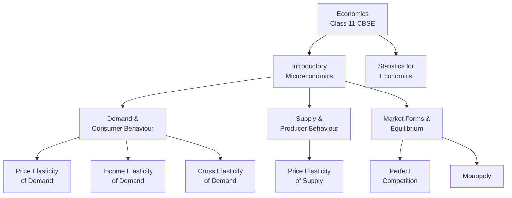

# Economics — Subject Map

> **Subject:** Economics | **Grade:** Class 11 | **Board:** CBSE

---

## Curriculum Overview

---

## Part A — Introductory Microeconomics

### Unit 1: Introduction
- What is Economics?
- Central Problems of an Economy
- Production Possibility Frontier

### Unit 2: Consumer Behaviour and Demand
- [[Demand and Law of Demand]]
- [[Price Elasticity of Demand]]
- [[Income Elasticity of Demand]]
- [[Cross Elasticity of Demand]]
- Indifference Curve Analysis

### Unit 3: Producer Behaviour and Supply
- Production Function
- Costs: Fixed, Variable, Total, Average, Marginal
- Revenue: Total, Average, Marginal
- [[Price Elasticity of Supply]]

### Unit 4: Forms of Market
- [[Perfect Competition]]
- [[Monopoly]]
- Monopolistic Competition
- Oligopoly

### Unit 5: Price Determination
- Market Equilibrium
- Effect of Shifts in Demand and Supply

---

## Part B — Statistics for Economics

### Unit 6: Statistics
- Collection and Organisation of Data
- Presentation of Data (Tables, Diagrams, Graphs)
- Measures of Central Tendency (Mean, Median, Mode)
- Measures of Dispersion
- Correlation
- Index Numbers

---

## Exam Weightage (CBSE Class 11)

| Unit | Marks |
|------|-------|
| Introduction | 7 |
| Consumer Behaviour & Demand | 13 |
| Producer Behaviour & Supply | 13 |
| Forms of Market | 10 |
| Price Determination | 7 |
| Statistics for Economics | 30 |
| **Total** | **80** |

---

## Practice Notes

- [[Price Elasticity of Demand — Practice]]
- [[Market Equilibrium — Practice]]

## Sources

NCERT, *Introductory Microeconomics*, Class 11
NCERT, *Statistics for Economics*, Class 11
