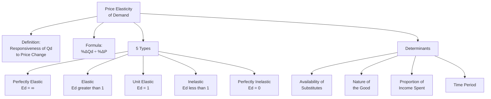

# Price Elasticity of Demand

## 🪝 Hook

Salt prices doubled overnight in your city. How much less salt did people buy? Almost none.
Now imagine Netflix raised its subscription price by the same percentage. Thousands cancelled.
Same price change — completely different reactions. That difference *is* elasticity.

---

## 🗺️ Concept Map

---

## 📚 Layered Explanation

**Layer 1 — The Tweet:**
Price Elasticity of Demand measures how sensitive consumers are to a price change — a high number means they react a lot; a low number means they barely change their buying habits.

**Layer 2 — The Engine:**
When a firm raises its price, two things can happen: consumers either switch to alternatives (elastic demand) or keep buying because they have no choice (inelastic demand). The formula captures this mathematically:

$$E_d = \frac{\% \Delta Q_d}{\% \Delta P} = \frac{\Delta Q_d / Q_d}{\Delta P / P}$$

Since demand curves slope downward, price and quantity move in opposite directions — so PED is always negative. By convention, we take the absolute value.

**Layer 3 — The Nuance:**
- Elasticity varies *along* a straight-line demand curve — it is not constant.
- At the midpoint of a linear demand curve, Ed = 1 (unit elastic).
- Above the midpoint: elastic. Below the midpoint: inelastic.
- Total Revenue (TR = P × Q) is maximised at the unit elastic point — a favourite exam question.

---

## 🔢 Worked Examples

**Example 1 — Basic Calculation:**
Price of tea rises from ₹40 to ₹50 per 100g. Quantity demanded falls from 200 units to 160 units.

$$E_d = \frac{(200-160)/200}{(50-40)/40} = \frac{20\%}{25\%} = 0.8$$

Since |Ed| = 0.8 < 1, demand is **inelastic**. (Tea has few close substitutes.)

**Example 2 — Total Revenue Test:**
A firm sells 100 units at ₹10 (TR = ₹1,000). Price rises to ₹12; quantity falls to 70 units (TR = ₹840).
TR fell → demand was **elastic** (Ed > 1). When demand is elastic, a price rise *reduces* revenue.

**Example 3 — Identifying Type from Context:**
Insulin for a diabetic patient: Ed ≈ 0 (perfectly inelastic — no substitute, life necessity).
Luxury sports car: Ed > 1 (elastic — large share of income, many alternatives at that price point).

---

## 🧠 Analogy

Think of a rubber band. Stretch it a little (small price change) — if demand is elastic, it springs back a lot (big quantity change). If it's inelastic, the band barely moves no matter how hard you pull. The "elasticity" of the rubber band *is* the elasticity of demand.

---

## 📌 Key Points

- **Formula:** Ed = % Change in Qd ÷ % Change in Price (always take absolute value)
- **Ed > 1:** Elastic — consumers are sensitive (luxuries, goods with substitutes)
- **Ed < 1:** Inelastic — consumers are insensitive (necessities, habits, no substitutes)
- **Ed = 1:** Unit elastic — % change in Qd exactly equals % change in P
- **Ed = 0:** Perfectly inelastic — quantity unchanged regardless of price (e.g., insulin)
- **Ed = ∞:** Perfectly elastic — any price rise causes demand to drop to zero
- **TR Rule:** Price ↑ → TR ↑ if inelastic; TR ↓ if elastic; TR unchanged if unit elastic

---

## 🎯 Exam Corner

**Marks:** 3–6 marks in Unit Tests; can appear as a 6-mark long answer in board exams.

**Most common mistake:** Students forget to take the absolute value of Ed and write a negative number, losing a mark. Also common: confusing the *formula* with the *total revenue test* — they measure the same thing, different methods.

**Insider tip:** When a question gives you a demand schedule (table), always calculate the *midpoint* formula to get a more accurate Ed. If the question says "using the percentage method," use simple % change. Read the question carefully — both methods are in the syllabus.

---

## ❓ Self-Check

1. **WHY** does demand for salt remain inelastic even when its price doubles?
2. **WHAT IF** a government wants to reduce cigarette consumption by raising taxes — would this work better on an elastic or inelastic good, and why?
3. **COMPARE** price elasticity of demand for a luxury car vs. a bus ticket. What single factor most explains the difference?

---

## 🔭 Further Questions

1. How does the concept of PED help a monopolist decide whether to raise or lower its price to maximise revenue?
2. If two goods are perfect substitutes, what would you expect the cross elasticity of demand between them to be, and why?

---

## 🔗 Related Notes

- [[Economics — Subject Map]]
- [[Demand and Law of Demand]]
- [[Income Elasticity of Demand]]
- [[Cross Elasticity of Demand]]
- [[Price Elasticity of Demand — Practice]]

---

## 📎 Sources

NCERT, *Introductory Microeconomics*, Class 11, Chapter 4, pp. 48–56
[[NCERT Economics Class 11 — Chapter 4 Elasticity]]
