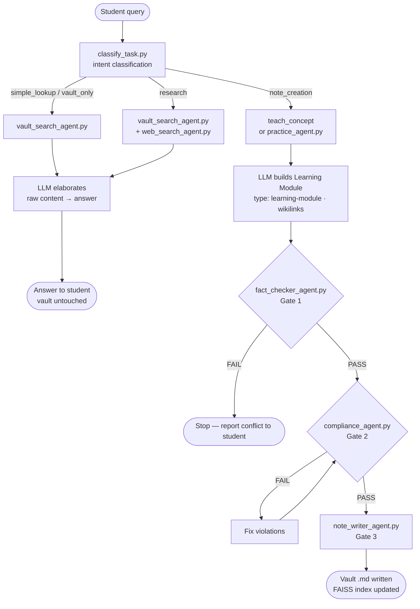

# Student Study Agent System

> A sophisticated AI-powered learning infrastructure built on Obsidian for exam preparation and subject mastery

[](https://www.python.org/downloads/)
[](LICENSE)

## 🎯 Mission

This is **NOT** a general-purpose chatbot or answer vending machine. It's a **coherent learning system** centered on durable student outcomes:

- ✅ **Mastery** over completion
- ✅ **Understanding** over memorized output
- ✅ **Durable learning artifacts** over ephemeral chat
- ✅ **Structured study workflows** inside an Obsidian vault

## 🏗️ Architecture

### Agent & Tool Model

The system ships **one governed agent definition** — [`00 - System/study.agent.md`](00%20-%20System/study.agent.md) —
which exposes 19 tools. The Copilot CLI agent is the LLM; the Python tools are
data fetchers and gate keepers. The agent acts as a **Master Elaborator**
(turning raw tool output into structured Learning Modules) and a **Socratic
Tutor** (guiding understanding through probing questions rather than answers).

| Capability | Tools |
|------------|-------|
| 🎯 **Governance** | `read_constitution` |
| 👤 **Profile** | `check_profile`, `create_profile`, `view_profile`, `add_subject`, `remove_subject`, `add_exam`, `write_student_card` |
| 🔀 **Routing** | `classify_intent` |
| 🧠 **Knowledge** | `search_vault`, `web_search`, `web_fetch` |
| 👨‍🏫 **Teaching** | `teach_concept` |
| ✍️ **Practice** | `generate_practice` |
| 🛡️ **Write gates** | `check_facts` → `check_compliance` → `write_note` |
| 🔧 **Maintenance** | `index_vault`, `archive_vault` |

### Technology Stack

```
Frontend:    Obsidian Plugin (chat interface, context-aware actions)
Backend:     Copilot CLI ACP Service (orchestration, tool use, workflow routing)
System of Record: Obsidian Vault (all durable learning artifacts)
Search:      FAISS Vector Index (semantic search)
Embeddings:  sentence-transformers (all-MiniLM-L6-v2)
Research:    Tavily API (web research when needed)
Language:    Python 3.14+
```

## 📁 Vault Structure

The workspace is organized into 10 canonical directories following a learning workflow:

```
Study_Agent/
├── 00 - System/        # Governance, agent tools, FAISS index, learner state
├── 01 - Inbox/         # Capture zone — student card, unsorted notes
├── 02 - Sources/       # Primary learning materials
├── 03 - Subjects/      # Curriculum maps & topic trees
├── 04 - Concepts/      # Deep-dive concept notes & learning modules
├── 05 - Practice/      # Quizzes, flashcards, drills
├── 06 - Plans/         # Revision schedules, exam prep plans
├── 07 - Outputs/       # Generated summaries, reports
├── 08 - Templates/     # Reusable note structures (tracked in git)
└── 99 - Archive/
    └── samples/        # ← Example notes showing the output format
```

> **Privacy:** Folders `01`–`07` and `99 - Archive/archived-*` are gitignored — your personal study content never leaves your machine. Only `00 - System`, `08 - Templates`, `99 - Archive/samples/`, and the repository's own config files are tracked.

### 👀 Sample Notes

Not sure what the agent produces? Browse real examples in [`99 - Archive/samples/`](99%20-%20Archive/samples/README.md):

| Sample | Type | Subject |
|--------|------|---------|
| [Student Card](99%20-%20Archive/samples/01%20-%20Inbox/Student%20Card%20-%20Aarav%20Sharma.md) | `student-card` | Profile auto-generated on first run |
| [NCERT Economics Ch.4](99%20-%20Archive/samples/02%20-%20Sources/NCERT%20Economics%20Class%2011%20%E2%80%94%20Chapter%204%20Elasticity.md) | `source` | Textbook source note |
| [Economics — Subject Map](99%20-%20Archive/samples/03%20-%20Subjects/Economics%20%E2%80%94%20Subject%20Map.md) | `subject-map` | Curriculum map with Mermaid topic tree |
| [Price Elasticity of Demand](99%20-%20Archive/samples/04%20-%20Concepts/Price%20Elasticity%20of%20Demand.md) | `concept` | Full Learning Module — Hook → Exam Corner → Self-Check |
| [A Photograph — Shirley Toulson](99%20-%20Archive/samples/04%20-%20Concepts/A%20Photograph%20%E2%80%94%20Shirley%20Toulson.md) | `learning-module` | English poetry module |
| [PED Practice](99%20-%20Archive/samples/05%20-%20Practice/Price%20Elasticity%20of%20Demand%20%E2%80%94%20Practice.md) | `practice` | MCQ + short/long answer + answer key |
| [A Photograph — Practice](99%20-%20Archive/samples/05%20-%20Practice/A%20Photograph%20%E2%80%94%20Practice%20Questions.md) | `practice` | Poetry extract + comprehension questions |
| [Economics — Revision Plan](99%20-%20Archive/samples/06%20-%20Plans/Economics%20%E2%80%94%20Revision%20Plan.md) | `revision-plan` | 4-week schedule with priority matrix |

## 🚀 Quick Start

### Prerequisites

- **Python 3.14+** installed
- **GitHub Copilot CLI** installed and authenticated
- **Obsidian** application installed
- **Tavily API Key** (optional — for web research)

### Installation

**For detailed setup instructions, see [SETUP.md](SETUP.md)**

The one-command path:

```powershell
& ".\00 - System\.agent\setup_windows.ps1"
```

This creates the venv, installs dependencies, extracts the embedding model,
builds the FAISS index, and runs the test suite.

### Run the agent

**Terminal:**

```powershell
copilot agent run "00 - System\study.agent.md"
```

**Obsidian:** enable the **Copilot ACP Agent** plugin, set `vaultPath` to this
vault and `promptPresetsText` to `study.agent.md`, then open the agent panel
from the left ribbon.

## 🔄 Learning Flow

Every request is classified first, then routed down one of three paths.



Read-only answers never touch the vault. Anything persistent must clear all
three gates in order.

## 🛡️ Governance & Control

This system follows strict governance policies:
- Vault containment (all artifacts in vault)
- File write governance (student approval for changes)
- Source grounding (trustworthy educational sources)

## 🤝 Contributing

See [CONTRIBUTING.md](CONTRIBUTING.md) for detailed guidelines.

## 📄 License

This project is licensed under the MIT License - see the [LICENSE](LICENSE) file for details.

## 📚 Documentation

- **[SETUP.md](SETUP.md)** - Detailed installation and configuration guide
- **[00 - System/Agent Architecture (C4+1).md](00%20-%20System/Agent%20Architecture%20%28C4%2B1%29.md)** - System design
- **[00 - System/Vault Constitution.md](00%20-%20System/Vault%20Constitution.md)** - Binding governance rules
- **[CONTRIBUTING.md](CONTRIBUTING.md)** - Contribution guidelines
- **[CHANGELOG.md](CHANGELOG.md)** - Version history and updates

---

**Remember:** This is a learning system focused on mastery, not a homework solver. Use it to build understanding, not to bypass learning.